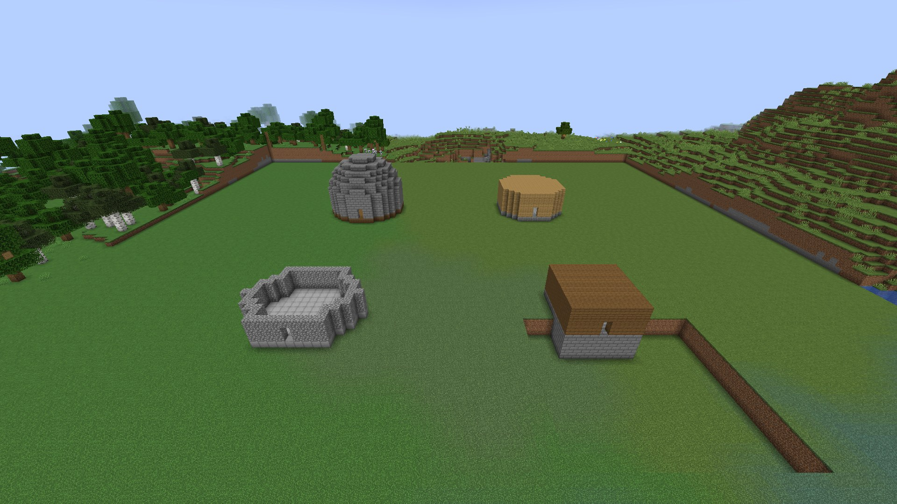
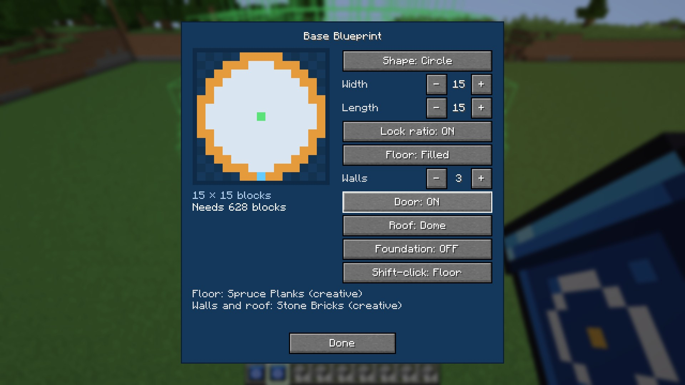
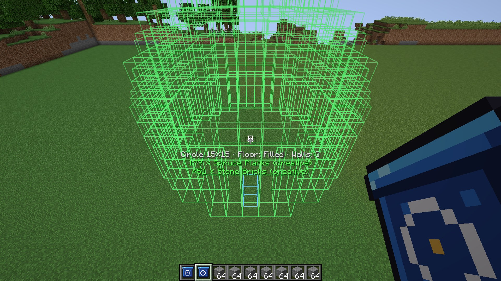
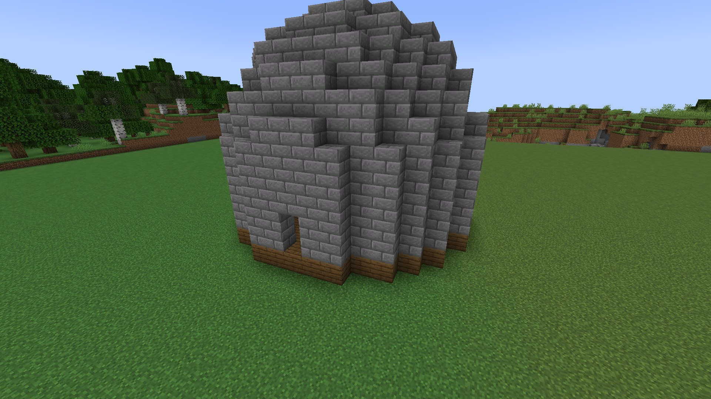
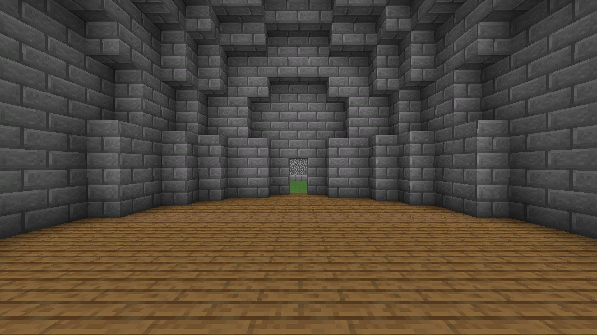
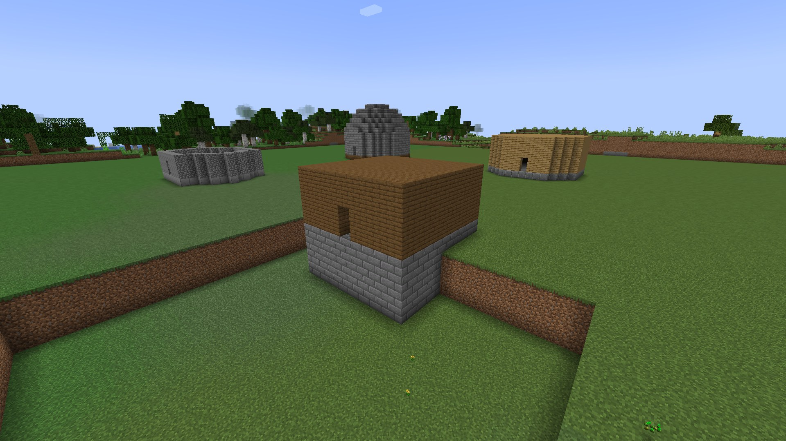
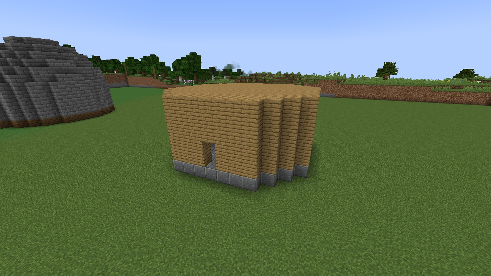
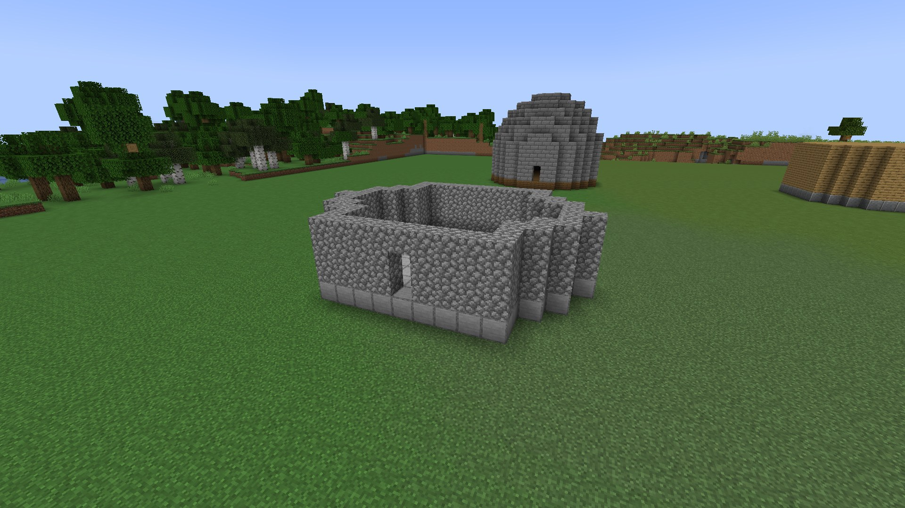
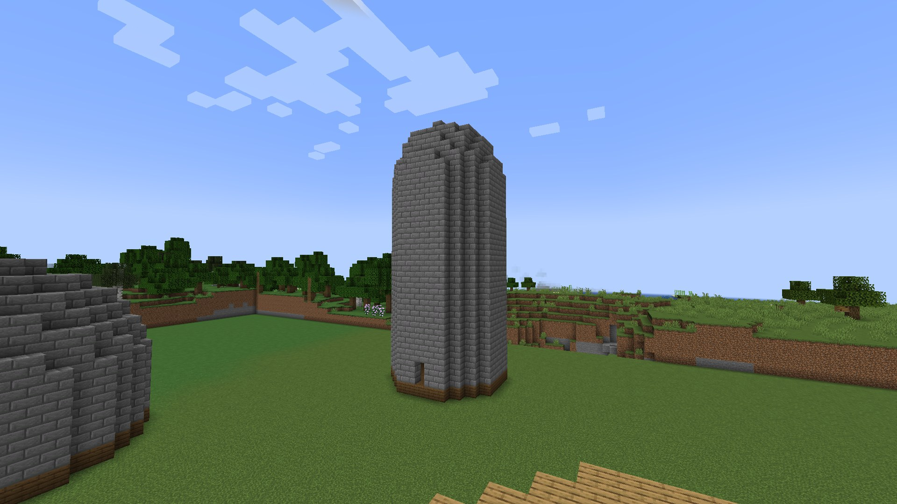
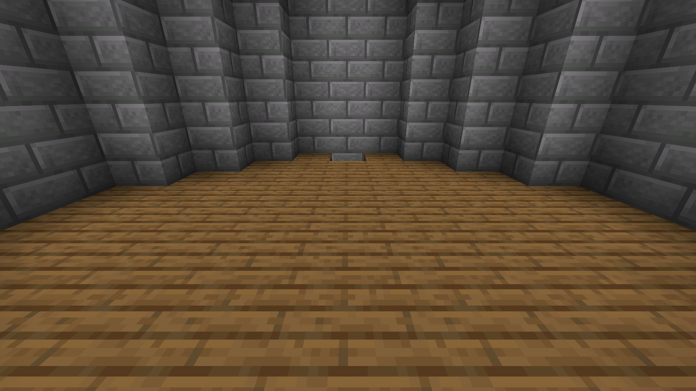

<p align="center"></p>

# Planta de Base (Base Blueprint)

Mod para **Minecraft 1.21.1 (NeoForge)**. Um item de early game que constrói a base de uma vez:
um piso redondo, quadrado, octogonal ou hexagonal, com paredes, porta, teto ou cúpula opcionais, do
tamanho que você escolher, usando blocos do seu inventário, da sua mochila e dos baús por perto. O círculo segue a mesma regra dos geradores de círculo em pixel
(como o donatstudios PixelCircleGenerator).

## Imagens
| | |
|---|---|
|  |  |
|  |  |
|  |  |
|  |  |
|  |  |

## Receita
Sem forma: **Mesa de trabalho + 3 Papéis**.

Cada planta constrói **8 bases** e depois se gasta (o desfazer não devolve o uso). No criativo não gasta.
Conserta na bigorna com papel.

## Como usar
| Ação | O que faz |
|---|---|
| Clique direito no ar ou tecla **N** | Abre o menu: forma (círculo, quadrado, octógono, hexágono), largura, comprimento, piso (cheio / contorno / sem piso), altura das paredes, **andares**, porta, teto (nenhum / plano / cúpula), fundação e o que o Shift-clique escolhe (piso ou paredes). Tem prévia em pixels. Shift nos botões +/- muda de 5 em 5 |
| Shift + clique direito num bloco | Escolhe esse bloco como material **do piso** ou **das paredes e do teto**, conforme a opção "Shift-clique" do menu. Sem material de parede, as paredes usam o do piso |
| Bloco na mão secundária | Tem prioridade e vale para tudo |
| Segurar a planta e mirar num bloco | Mostra o contorno da base no mundo (verde = blocos suficientes, vermelho = faltam) e a contagem abaixo da mira |
| Clique direito num bloco | Constrói a base centrada ali |
| Shift + clique direito no ar | Desfaz a última base e devolve os blocos |

- **Andares:** empilha quantos andares quiser (até 16), cada um com a altura das paredes e um piso entre eles, com um
  buraco de 1×1 junto à parede oposta à porta para você pôr uma escada. O teto ou a cúpula vai no topo. Dá para fazer torres.
- **Porta:** abre um vão de 1×2 no meio da parede virada para você, só no térreo.
- **Teto:** plano (cobre toda a base uma camada acima das paredes) ou **cúpula** (meia esfera oca sobre a base; só no círculo, nas outras formas vira teto plano). Precisa de paredes.
- **Fundação:** em terreno mais baixo, preenche embaixo do piso até o chão, com o material do piso (até `maxFoundation` blocos).
- Os blocos vêm do **inventário**, de **mochilas e outros recipientes carregados** nele e de **baús a até `containerRadius` blocos** que você pode abrir. Se faltar, nada é construído e a mensagem diz quantos faltam. No criativo é de graça.
- Só ocupa espaços vazios ou substituíveis (ar, grama alta, neve). Se algum ponto estiver ocupado (tronco, folhas, terreno mais alto), a base **não é construída**: os pontos aparecem em vermelho na prévia para você limpar ou mudar de lugar. O servidor pode liberar construção parcial com `allowPartial`.
- Respeita proteção de spawn e mods de claim (cada bloco dispara o evento de colocação).
- Quem estiver em cima da área é levantado para cima do piso.
- O desfazer fica salvo com o mundo: continua funcionando depois de sair ou reiniciar o servidor.

## Configuração (`world/serverconfig/baseblueprint-server.toml`)
- `maxSize` (padrão 64): maior largura/comprimento.
- `maxWallHeight` (padrão 16): parede mais alta.
- `allowUndo` (padrão true).
- `allowPartial` (padrão false): constrói mesmo com pontos ocupados, deixando buracos neles.
- `containerRadius` (padrão 8): distância dos baús de onde os blocos podem vir; 0 = só o inventário.
- `maxFoundation` (padrão 8): profundidade máxima da fundação.

## Build
```
./gradlew runShots             # monta bases de exemplo e tira as imagens de docs/screenshots (run/screenshots)
./gradlew build                # jar em build/libs/baseblueprint-<versão>.jar
./gradlew runGameTestServer    # testes in-game
./gradlew runClient            # cliente de desenvolvimento
```
A textura é editável no Pontilha: `art-src/base_blueprint.pontilha`.

## Mudanças
### 1.2.0
- **Andares:** paredes, piso entre os andares e um buraco para a escada; teto ou cúpula no topo. Faz torres.
- A planta tem **8 usos**: cada base construída gasta um; no criativo não gasta. Conserta na bigorna com papel.
  A dica do item mostra os usos restantes.

### 1.1.2
- Receita: mesa de trabalho + 3 papéis (antes: mesa + graveto).

### 1.1.1
- Menu: o botão "Shift-clique" não corta mais o texto; no criativo, a linha do material diz só "(criativo)".

### 1.1.0
- Material separado para o piso e para as paredes e o teto (opção "Shift-clique" no menu).
- Porta automática na parede virada para o jogador.
- Teto plano ou cúpula (meia esfera oca, no círculo).
- Formas novas: octógono e hexágono.
- Fundação em terreno irregular: preenche embaixo do piso até o chão.
- Os blocos também vêm de mochilas e de baús por perto (`containerRadius`).
- O desfazer fica salvo com o mundo.
